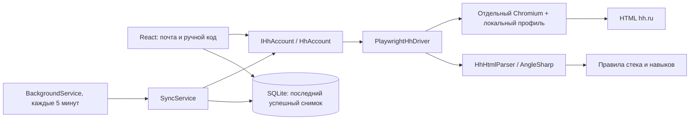

# Архитектура браузерной интеграции

Stack Scout — локальный монолит одного пользователя: .NET 10, React, SQLite, Playwright Chromium. Прежний адаптер API удалён; токены и Redirect URI не участвуют в работе.

## Состояния входа

`disconnected → codeRequired → authenticated`. `manualAction` означает, что hh.ru требует CAPTCHA, регистрацию, дополнительное подтверждение или появился неизвестный шаг. Неверный код оставляет `codeRequired`. Код без предыдущего запроса отклоняется. Повторные письма ограничены минутой.

`Busy` отделён от этапа входа. Семафор `HhAccount` сериализует запрос письма, проверку кода, ручную проверку, отключение и чтение вакансий. Параллельные действия отклоняются с понятным сообщением. Второй семафор `SyncService` исключает параллельные полные синхронизации.

Статус содержит маскированную почту и безопасные сообщения. Сырой текст ошибок формы, почта и OTP в статус не копируются. Код не сохраняется в SQLite. Логи Playwright, трассы, видео и снимки формы входа не включены.

Отсутствие поля OTP не считается успешным входом. Проверяются видимые признаки профиля соискателя; гостевой `mainmenu_profile-link mainmenu_loginButton` не подтверждает авторизацию. При истечении сессии загрузка блокируется. Наличие директории профиля позволяет попытаться восстановить вход, но не доказывает его.

## Браузер

Playwright запускает отдельный persistent context в `data/hh-browser`, без обычного пользовательского Chrome/Edge-профиля. По умолчанию окно видно для ручных проверок. Авторизация и выдача используют отдельные вкладки общего контекста. Все страницы открываются только на hh.ru; скрытые внутренние API не вызываются.

Почтовая форма использует наблюдавшиеся `data-qa` и роли. Для OTP поддерживаются поле с `autocomplete=one-time-code`, распространённые имена полей и отдельные цифровые ячейки. CAPTCHA классифицируется как ручное действие; автоматического решения и обхода ограничений нет.

`PlaywrightHhDriver` отвечает за UI сайта, а `HhAccount` — за переходы и доступ к источнику. Это позволяет проверять переходы без браузера и отдельно прогонять настоящий Chromium на изолированных HTML-страницах. `IHhBrowserDriver` подменяется в тестах без изменения продуктового кода.

Отключение закрывает контекст и удаляет только выделенный `data/hh-browser`. Перед рекурсивным удалением проверяются абсолютный путь и имена родителя/директории. Остальные сессии аккаунта hh.ru не отзываются.

## Сбор вакансий

`/search/vacancy` открывается с запросом, регионом, сортировкой по публикации и `enable_snippets=true`. Читаются до `Hh:MaxPages` страниц (1–10), между страницами пауза секунду. Число карточек на странице определяет hh.ru. Ссылки `pager-page` определяют наличие следующей страницы.

AngleSharp разбирает HTML по `data-qa`. Значение атрибута карточки может содержать несколько токенов. Для рекламного заголовка с tracking-ссылкой применяется ID контейнера, а итоговая ссылка строится на hh.ru. Требования и задачи берутся из snippets, навыки — из тегов либо словаря. Рейтинг/число отзывов читаются с карточки; тексты отзывов не загружаются.

Зарплата сохраняет валюту, налоги и период. Фильтр месячной зарплаты не сравнивает её с почасовой/посменной и неизвестной по периоду. При отсутствии даты публикации сохраняется время наблюдения с отдельным флагом `PublicationDateKnown=false`; UI подписывает его как время проверки.

Пустая выдача принимается только при явном соответствующем признаке. Неизвестная разметка не превращается в пустой успешный снимок. При ошибке любой страницы предыдущие данные сохраняются. После успеха снимок и его метаданные атомарно заменяются в SQLite; ID дедуплицируются.

## Фильтры

Сначала `StackPolicy` исключает другой основной стек и посторонние роли, затем применяются обязательные навыки по AND, числовые фильтры и покрытие навыков. Процент не оценивает seniority или опыт и зависит от полноты snippets.

Ручные `CompanyInfo` имеют приоритет. Если их нет, рейтинг и число отзывов подставляются из последнего наблюдения карточки с `FromWebsite=true`. Размер компании остаётся неизвестным до ручного ввода. Неизвестные значения обрабатываются явно, без замены нулями.

## Сопроводительные письма

`CoverLetterService` вызывается из явного POST `/api/vacancies/{id}/cover-letter`. Ни `PollingWorker`, ни GET контекста, ни конструкторы не запускают модель. Открытие React-окна делает только GET контекста SQLite и GET проверки штатного входа `codex login status`. Отдельная кнопка описания читает hh.ru без модели.

Синхронизация атомарно заменяет текущую выдачу и обновляет `vacancy_archive`. Таблицы `vacancy_details` и `cover_letters` сохраняются независимо от неё. Полное описание выбранной вакансии читается из `vacancy-description` в отдельной вкладке общего Chromium, через тот же семафор аккаунта. Удалённая/неизвестная разметка не подменяется snippet. Описание сохраняется с датой и SHA-256. Архив мигрирует автоматически из существующей таблицы вакансий при открытии базы.

Каждая версия письма сохраняет исходный и редактируемый текст, модель, даты, версию prompt, снимок локального профиля и вакансии с полным описанием. В HTTP-представление письма снимок резюме не включается. Изменение актуального резюме/описания определяется по хешам и показывается в UI. Новый запрос с `Regenerate=true` добавляет версию; обычный запрос возвращает уже существующую. Семафор отклоняет параллельные генерации с HTTP 409; ошибок с автоматическим повтором нет.

`CodexLetterGenerator` использует официальный `codex exec` со штатным ChatGPT-входом, без собственного OAuth и извлечения токенов. Дочерний процесс запускается без shell; prompt поступает через stdin, ответ — JSONL + JSON Schema. Вход с API-ключом отклоняется, переменные `OPENAI_*` удаляются. Генерация использует `--ignore-user-config`, `--ephemeral`, sandbox `read-only`, `approval_policy=never`, отключённые инструменты/интеграции и web search. При неожиданном tool-событии, незавершённом ходе или некорректной схеме текст не сохраняется.

При `auto` сначала выбирается `gpt-6.1-sol`, затем `gpt-6.1-terra` только при явном отказе доступа к модели. Ошибки квоты/сети/входа не включают fallback. Проверка каталога/входа не гарантирует доступ к конкретной модели; тестового inference при запуске нет. Таймаут/отмена завершают собственный дочерний процесс и сохраняют прежние версии. Поддерживаемые процессы и модель подменяются для тестирования без расходов ChatGPT.

## Границы локального сервиса

Сервис слушает localhost, принимает JSON и отклоняет посторонний Origin при изменениях. Состояние API отдаётся с `Cache-Control: no-store`. Это локальный инструмент, а не опубликованный многопользовательский сервис.

Сессия хранится на диске и содержит данные входа. Она исключена из Git; передавать каталог браузера третьим лицам нельзя. Токены API не используются. Авторизация почтой не предоставляет приложению доступ к почтовому ящику — код вводится человеком.

История откликов, резюме из аккаунта, чаты и автоматическая отправка сообщений сейчас не реализованы. Дальнейшее расширение должно быть отдельным от чтения вакансий.
